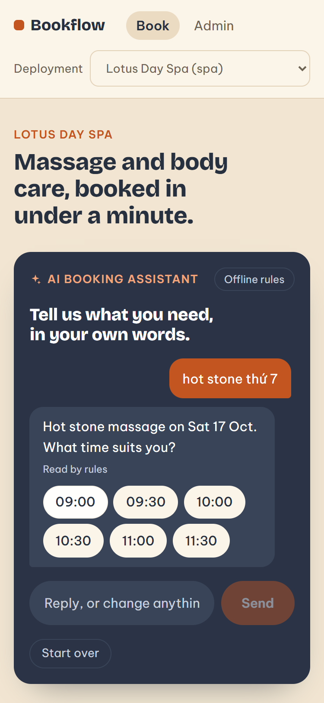
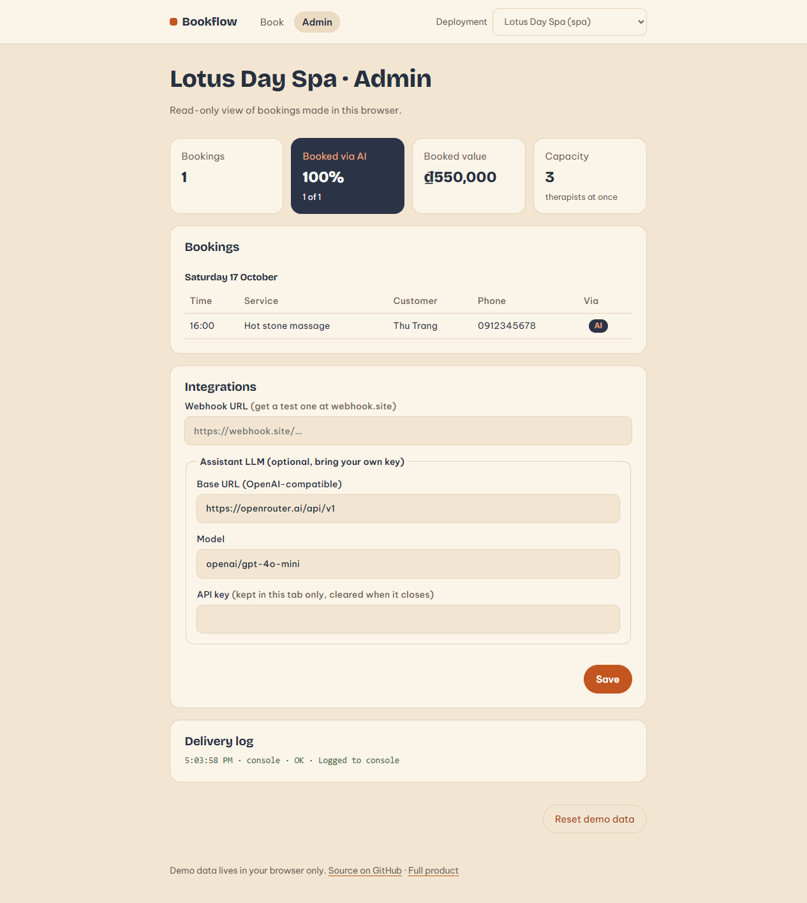

# Bookflow

A small, config-driven booking app with an **AI booking assistant**, for appointment-based service businesses: spas, clinics, salons.

**Live demo:** https://hoangvanngoc.github.io/bookflow/ (everything runs in your browser; no account, no backend)

Bookflow is a deliberately small codebase that shows how I approach **forward deployment**: take one product, fit it to a specific business quickly, plug it into the tools that business already uses, and leave behind something the customer's team can operate.

<p>
  
  
</p>

> This is a showcase project with fictional businesses and data. It is not a production system: there is no auth, no server-side storage, and no payment handling.

## What it does

### AI booking assistant

Customers book the way they already write to a shop: one short message, often in shorthand and mixed languages.

- Type `body massage tomorrow 3pm` or `mai 3h chiều massage chân` and the booking form fills itself.
- **It asks back instead of failing.** Missing the time? It offers the free slots. Requested time taken? It offers the closest ones. Shop closed that day? It suggests the next open days. Every follow-up is one tap.
- **Follow-ups keep context.** Reply `4h chiều` and only the time changes; the service and day from the first message stay.
- **Two engines, one contract.** A rule parser (English + Vietnamese) runs offline and free by default. Add your own key for any OpenAI-compatible model and the LLM takes over, but its output is validated against the real catalogue and falls back to the rules when it is wrong.
- **Measured.** The admin view shows the share of bookings that came through the assistant, the number that tells you whether it is worth keeping.

### Book over Zalo chat

Most customers of small Vietnamese businesses never open a booking page; they message the shop on Zalo. Bookflow can answer on the shop's **Zalo Official Account**:

- The same conversation engine runs behind a Zalo OA webhook. Chat has no buttons, so choices go out as a numbered list and the customer replies "3".
- The adapter verifies Zalo's `X-ZEvent-Signature`, keeps a chat session per customer, re-checks the slot before booking, and replies through the OA message API.
- The demo's **Zalo chat** page simulates the whole conversation in the browser and shows the exact request the webhook would send to Zalo.
- A deployable [Cloudflare Worker example](examples/zalo-oa-worker) wires it to KV storage. No credentials are in this repo: the Worker reads them from secrets.

### Everything around it

- **Booking flow**: the same booking step by step, for people who prefer tapping.
- **Admin view**: bookings grouped by day with how each was made, booked value, and a log of every notification sent.
- **Three deployments from one build**: switch between a spa, a dental clinic and a hair salon in the header. Each one is a single JSON file, including the example messages the assistant suggests.
- **Integrations**: every booking is fanned out to notification channels. The demo ships a console channel and a generic webhook; point it at [webhook.site](https://webhook.site) to watch the payload arrive.

## Why it is built this way

| Customer-deployment problem | How the code handles it |
| --- | --- |
| Every business is different (hours, services, capacity, words customers use) | [`src/verticals/*.json`](src/verticals) holds everything that varies. Onboarding a business is a config file, not a fork. |
| Every business already has tools (a chat app, a CRM, a spreadsheet) | [`NotificationChannel`](src/lib/channels/types.ts) is a one-method interface. The [webhook adapter](src/lib/channels/webhook.ts) covers Zapier, Make, n8n or a custom endpoint on day one. |
| One broken integration must not lose a booking | [`dispatch`](src/lib/channels/index.ts) uses `Promise.allSettled`; failures are logged, the booking stands. |
| Storage depends on the customer's stack | UI talks to a [`BookingRepository`](src/lib/store.ts) interface. The demo uses browser storage; a real deployment swaps in its backend. |
| Customers write in their own language and shorthand | [Rule parser](src/lib/assistant/parse.ts) first: offline, free, predictable. [LLM](src/lib/assistant/llm.ts) only as an upgrade, and its output is validated against the real catalogue before use. |
| Customers live in chat apps, not on booking pages | [`conversation/engine.ts`](src/lib/conversation/engine.ts) is channel-agnostic: state in, reply out. The [Zalo adapter](src/lib/channels/zalo) only handles signature, transport and storage. |
| Half the messages are incomplete | [`planReply`](src/lib/assistant/reply.ts) turns a partial request into one follow-up question with tappable answers, as a pure, tested function. |
| No double bookings, ever | [`availableSlots`](src/lib/slots.ts) counts overlapping bookings against capacity, conservatively. |

More on this in [docs/ARCHITECTURE.md](docs/ARCHITECTURE.md), the onboarding runbook in [docs/DEPLOYMENT.md](docs/DEPLOYMENT.md), and the reasoning behind the scope in [docs/CASE_STUDY.md](docs/CASE_STUDY.md).

## Run it

Requires Node.js 22+ and pnpm (`corepack enable`).

```bash
pnpm install
pnpm dev          # http://localhost:3000
pnpm test         # slots, parser (EN + VI), follow-up planner, chat engine, Zalo webhook, LLM validation, channels
pnpm build        # static export to ./out
```

## Onboard a new business in five minutes

1. Copy [`src/verticals/spa.json`](src/verticals/spa.json) to `src/verticals/yoga.json` and edit the name, hours, capacity, services and keywords.
2. Register it in [`src/verticals/index.ts`](src/verticals/index.ts).
3. `pnpm test && pnpm build`. It appears in the deployment switcher.

## Try the LLM assistant

Open **Admin → Integrations**, set any OpenAI-compatible base URL, model and **your own** API key. The key stays in `sessionStorage` for that tab only. Neither this repo nor the hosted demo contains a key.

## Tech

Next.js 16 (static export) · React 19 · TypeScript · Vitest · GitHub Actions · GitHub Pages. No runtime dependencies beyond React and Next.

## License

[MIT](LICENSE)
